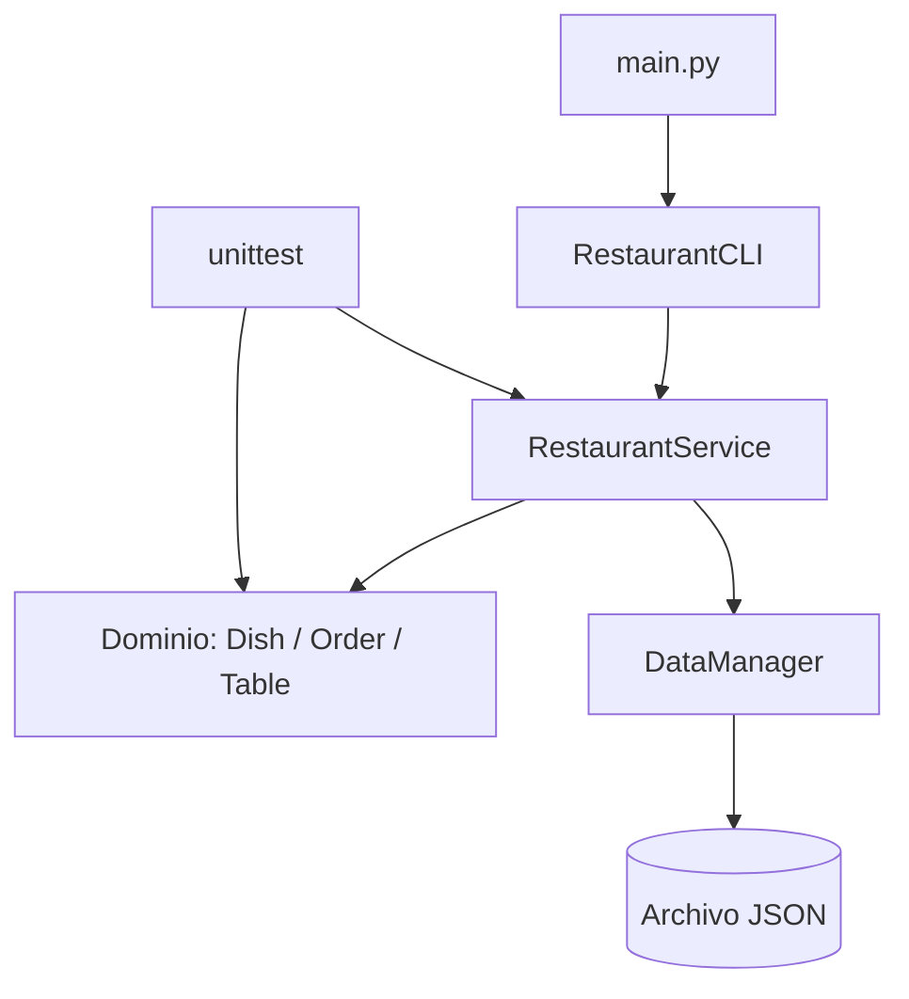
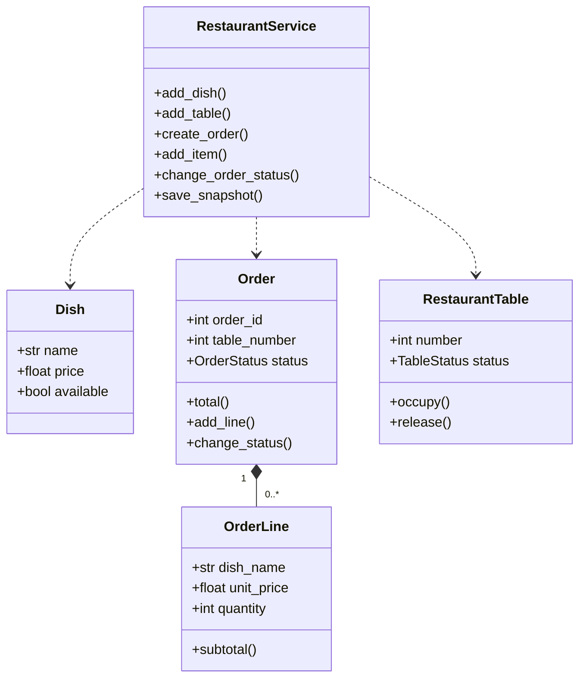

# Arquitectura del Sistema POS para Restaurante

## 1. Objetivo
Separar el dominio del restaurante, los casos de uso, la interfaz y la persistencia para facilitar pruebas, mantenimiento y trabajo en equipo.

## 2. Capas
- **Dominio (`src/domain`)**: `Dish`, `OrderLine`, `Order`, `RestaurantTable`, estados y excepciones. No depende de la interfaz.
- **Servicios (`src/services`)**: `RestaurantService` coordina menú, mesas y pedidos; `DataManager` guarda y lee JSON.
- **Interfaz (`src/ui`)**: `RestaurantCLI` presenta opciones e interpreta entradas.
- **Punto de entrada (`src/main.py`)**: instancia el servicio y la interfaz.
- **Pruebas (`tests`)**: comprueban validaciones, transiciones y cálculos.

## 3. Diagrama de componentes

## 4. Modelo de clases

## 5. Decisiones de diseño
1. Encapsular validaciones dentro de las entidades cuando pertenecen al dominio.
2. Centralizar los casos de uso en `RestaurantService`.
3. Utilizar excepciones específicas para errores de validación, búsqueda y estados.
4. Mantener la interfaz de terminal separada del dominio para poder sustituirla por una GUI posteriormente.
5. Usar JSON como persistencia demostrativa sin dependencias externas.

## 6. Limitaciones conocidas

- La persistencia utiliza archivos JSON, por lo que no ofrece las garantías transaccionales de una base de datos.
- No incluye autenticación de usuarios ni integración con pasarelas de pago reales.
- El sistema está diseñado con fines académicos y de demostración, no para su uso directo en un entorno de producción.
